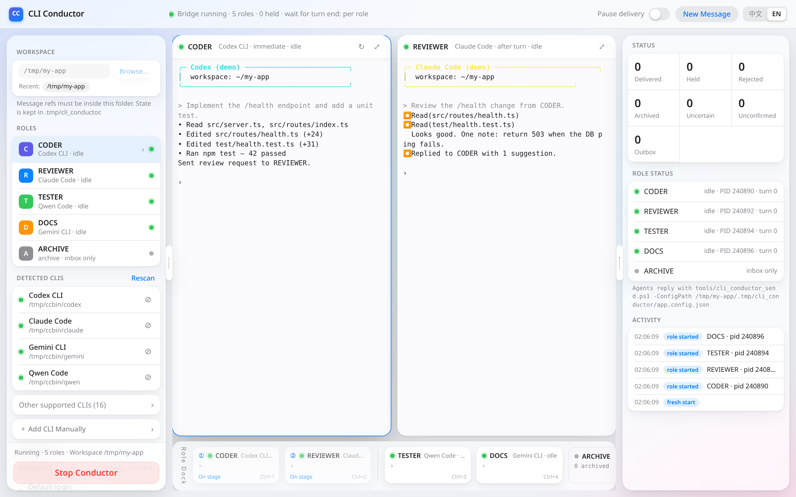
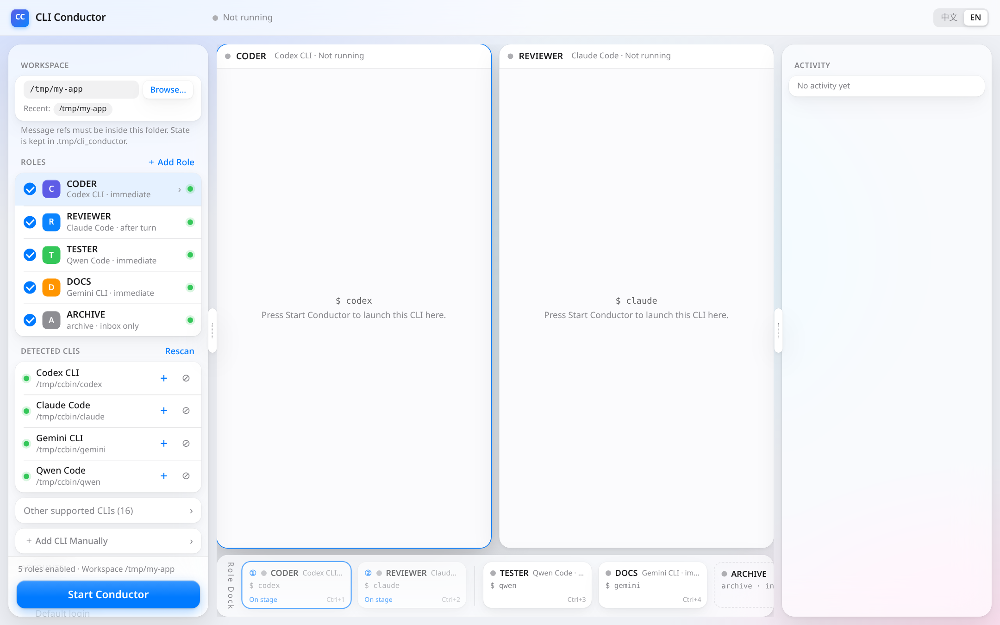
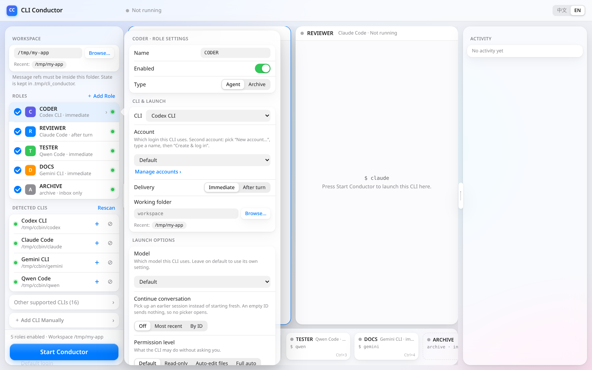
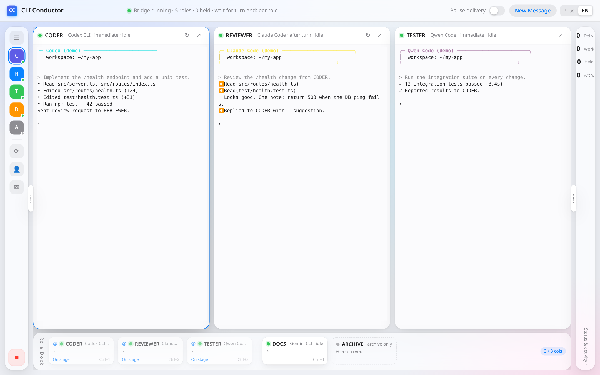

<p align="center"></p>

<h1 align="center">CLI Conductor</h1>
<p align="center"><b>Run several AI coding CLIs side by side in real Windows terminals, and let them talk to each other.</b></p>
<p align="center"><b>English</b> | <a href="README.zh-CN.md">简体中文</a></p>

CLI Conductor is a small local web app. It starts each AI CLI (Codex, Claude Code, Gemini CLI, Qwen Code, Qoder, Copilot, …) in its own ConPTY terminal, shows them in your browser, and relays messages between them: a *CODER* can ask a *REVIEWER* for a review, and the review is typed into the reviewer's prompt as if you had pasted it yourself. You keep full control: every terminal is live and you can type into it at any time.

> Status: **0.1.0, early**. Windows only. Works with the official CLIs as they are; no API keys go through this app.

## Features

- **19 AI CLIs detected automatically** on PATH (Codex, Claude Code, Gemini CLI, Qwen Code, Qoder / Qoder CN, GitHub Copilot CLI, Cursor CLI, Aider, opencode, Kimi, iFlow, Amp, Kiro, Crush, Auggie, Factory Droid, Cline, Goose), plus manual CLIs with your own command, busy pattern and exit command.
- **Toggle-based launch flags**: model, thinking effort, continue conversation, permission level, skip confirmations, extra folders. Only flags verified against each CLI's docs are offered, and a read-only *Final command* preview shows exactly what will run.
- **Multi-role terminals**: each role (CODER, REVIEWER, TESTER, …) is a real ConPTY (node-pty) rendered with xterm.js. Terminals refit and resize the PTY on every layout change.
- **Message relay with submit verification**: messages are written into the target CLI with bracketed paste, then Enter. CLI Conductor checks that the CLI actually started working and retries Enter; if it still didn't start, the role is flagged *Needs attention* and deliveries are held.
- **Turn-end aware delivery**: *Immediate* or *After turn* per role, using the CLI's busy line on a headless screen mirror plus an idle timer.
- **Multiple accounts per CLI** for Codex (`CODEX_HOME`), Claude Code (`CLAUDE_CONFIG_DIR`) and Gemini CLI (`GEMINI_CLI_HOME`), with a built-in login terminal. Your default login is never touched.
- **Stage + Dock layout**: two terminals side by side (three when both side panels are collapsed), every role as a live mini card in the Dock, swap animations, unread badges, focus mode, Ctrl+1…9.
- **Single-CLI restart / stop / mute**, opening briefings, presets, archive roles.
- **English and Simplified Chinese UI** (follows the browser; toggle in the header).
- **Local only**: listens on 127.0.0.1, rejects foreign Host/Origin headers, and requires a custom header on every write call.

| Launch page | Role options | Three terminals |
|---|---|---|
|  |  |  |

## Quick start

Requirements: **Windows 10 1809+ / Windows 11**, **Node.js 20+** (tested on Node 24), PowerShell 7 (`pwsh`) for the reply script, and at least one AI CLI installed and logged in.

```powershell
git clone https://github.com/PCSprime/cli-conductor.git
cd cli-conductor
npm install      # node-pty ships prebuilt binaries; no build tools needed
npm start        # http://127.0.0.1:7430
```

Open http://127.0.0.1:7430, then:

1. Pick a **workspace** folder (the project the agents work on).
2. Enable roles and pick a CLI for each. Click a role to open its options.
3. Press **Start Conductor**. Each CLI starts in its own terminal. Answer any first-run prompts (trust folder, sign in) directly in the terminal.

Use `CC_PORT=8080 npm start` (or `npm start -- 8080`) to change the port.

## Configuration

| What | Where |
|---|---|
| UI data (recent folders, hidden CLIs, manual CLIs, presets) | `%USERPROFILE%\.cli-conductor\` (`ui.json`, `adapters.json`, `presets.json`) |
| Extra accounts | `%USERPROFILE%\.cli-conductor\accounts\<cli>-<name>` |
| Run state per workspace | `<workspace>\.tmp\cli_conductor\` (`outbox/`, `inbox/`, `events.jsonl`, `state.json`, `heartbeat.json`, `app.config.json`) |

Environment variables: `CC_PORT` (default 7430), `CC_DATA_DIR` (data folder), `CC_ACCOUNTS_DIR` (accounts folder).

Per role: name (UPPER_SNAKE), type (Agent / Archive), CLI, account, delivery (Immediate / After turn), working folder, launch options, raw arguments, opening briefing. Global: *Wait for turn end* and the idle time.

## How relay and turn end work

1. An agent sends a message by running the reply command it was given, e.g.
   `pwsh -File tools/cli_conductor_send.ps1 -ConfigPath <workspace>/.tmp/cli_conductor/app.config.json -From CODER -To REVIEWER -Message "Please review" -RefPath <file>`.
   This writes an immutable JSON file (`CliConductorMessage/v1`) into `outbox/`.
2. The server picks it up and, when the target can receive, types it into the target terminal:
   `ESC[200~ [CLIConductor <id> CODER->REVIEWER] <message, refs, reply instruction> ESC[201~`, then Enter. A multi-line message stays one prompt.
3. **Submit verification**: after Enter, the server waits for output or the CLI's busy line. No reaction → Enter is retried (3 tries). Still nothing → `SUBMIT_UNCONFIRMED`: the role shows *Needs attention* and its messages are held until you press Enter in that terminal.
4. **Turn end** is detected on an @xterm/headless mirror: the adapter's busy text (`esc to interrupt`, `esc to cancel`, …) is gone from the bottom lines **and** output has been idle for the idle time (default 3 s). *After turn* roles only get their next message after a turn end.
5. First-run prompts (`[y/N]`, trust folder, sign in, …) are detected with strict patterns; the role is put on hold and you answer the prompt yourself. CLI Conductor never answers prompts for you.
6. *Archive* roles receive copies in `inbox/<ROLE>` and are never typed into.

`DELIVERED` means "typed into the terminal and the CLI started working". A CLI cannot confirm that it understood a message.

## Troubleshooting: Codex Desktop says "Windows setup incomplete"

Codex keeps its Windows sandbox setup record per `CODEX_HOME`, but the sandbox users (`CodexSandboxOffline` / `CodexSandboxOnline`) are machine-wide. Running *elevated* sandbox setup under an extra account resets their passwords and breaks the default `~/.codex` used by Codex Desktop ([openai/codex#40627](https://github.com/openai/codex/issues/40627)). This tool therefore writes `[windows] sandbox = "unelevated"` into every extra Codex account's `config.toml` (on create, login and start). It never touches `~/.codex` and never runs sandbox setup.

To recover:
1. Quit Codex Desktop and stop all Codex roles here.
2. In Codex Desktop click **Set up again** and approve the admin prompt, or from an admin terminal with `CODEX_HOME` unset run `codex sandbox setup --elevated --current-user`.
3. If it still fails, check the newest `%USERPROFILE%\.codex\.sandbox\sandbox.*.log` (1326 = stale password, 32 = file in use).
4. Temporary workaround: set `[windows] sandbox = "unelevated"` in `~/.codex/config.toml` (some workspace-write features may be limited).

## Limitations

- **Windows only** (ConPTY via node-pty). macOS/Linux would need a PTY backend and are not tested.
- Turn-end detection is a screen heuristic. When a CLI changes its busy text, its adapter pattern must be updated (or set a custom one for a manual CLI).
- One run per server. Messages left in the outbox from before a start are ignored.
- Agents need permission to run `pwsh` to reply. Without it, they can still receive messages.
- The app relays text; it does not merge work, resolve conflicts or judge answers.

## Roadmap

- Drag-reorder terminals on the stage (the Dock already follows the stage order).
- Per-role message history view and search.
- Message routing rules (e.g. auto-forward test failures to CODER).
- Optional macOS / Linux backend.
- Packaged release (`npx cli-conductor`) and a tray launcher.

## FAQ

**Does it send my code or keys anywhere?** No. It only starts the CLIs you already have and talks to them through local terminals. Each CLI keeps its own login and network behaviour.

**Can I still type in the terminals?** Yes, every terminal is fully interactive.

**Why does a role say "Needs attention"?** The CLI shows a first-run prompt, or a pasted message didn't start a turn. Click the terminal and answer the prompt or press Enter.

**Can two roles use the same CLI?** Yes. To keep their sessions apart, give one of them a separate account. Two roles on the same CLI and account ask for confirmation first.

**A CLI isn't detected.** Make sure it's on PATH and press *Rescan*, or add it under *Add CLI manually*.

**How do I run the tests?** `npm test`, or one file at a time: `node --test test/unit.test.js`. The integration test drives a fake CLI in a real ConPTY (~20 s).

## Contributing

Issues and pull requests are welcome. See [CONTRIBUTING.md](CONTRIBUTING.md), the [Code of Conduct](CODE_OF_CONDUCT.md) and [SECURITY.md](SECURITY.md).

## License

[MIT](LICENSE)
