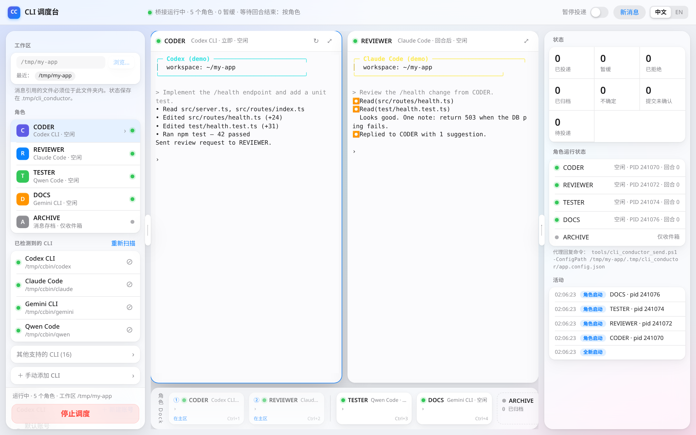
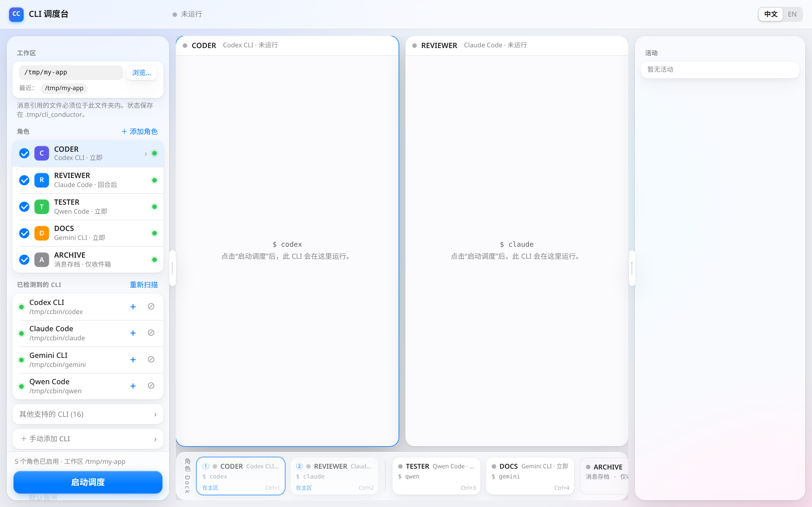
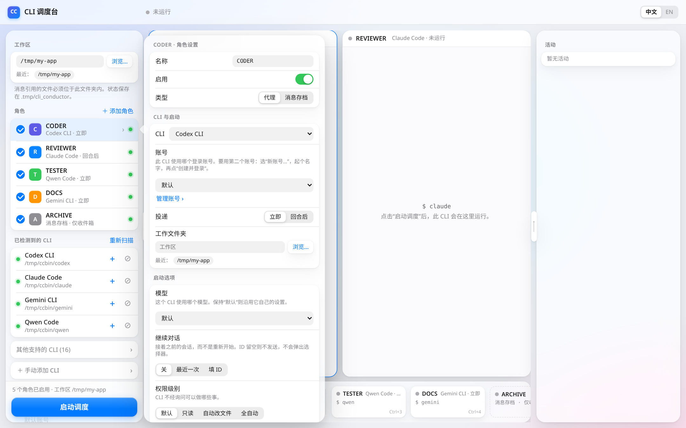
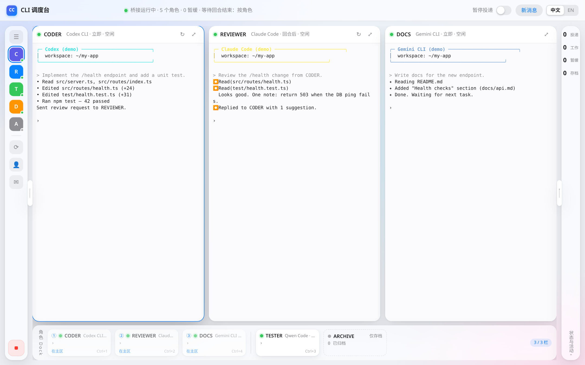

<p align="center"></p>

<h1 align="center">CLI 调度台（CLI Conductor）</h1>
<p align="center"><b>在真实的 Windows 终端里并排运行多个 AI 编程 CLI，并让它们互相传话。</b></p>
<p align="center"><a href="README.md">English</a> | <b>简体中文</b></p>
<p align="center">
  <a href="https://github.com/PCSprime/cli-conductor/actions/workflows/ci.yml"></a>
  <a href="https://github.com/PCSprime/cli-conductor/releases"></a>
  <a href="LICENSE"></a>
  
  = 20">
</p>

CLI 调度台是一个本地网页应用。它把每个 AI CLI（Codex、Claude Code、Gemini CLI、Qwen Code、Qoder、Copilot……）分别运行在独立的 ConPTY 终端中，在浏览器里显示，并在它们之间转发消息：*CODER* 可以请 *REVIEWER* 审查代码，审查请求会像你亲手粘贴一样输入到审查者的提示符里。所有终端都是实时可交互的，你随时可以直接输入。

> 状态：**0.2.0，早期版本**。仅支持 Windows。直接使用官方 CLI，本应用不经手任何 API 密钥。

## 功能

- **自动检测 PATH 上的 19 个 AI CLI**（Codex、Claude Code、Gemini CLI、Qwen Code、Qoder / Qoder 国内版、GitHub Copilot CLI、Cursor CLI、Aider、opencode、Kimi、iFlow、Amp、Kiro、Crush、Auggie、Factory Droid、Cline、Goose），也可手动添加 CLI（命令、忙碌匹配、退出命令）。
- **开关式启动参数**：模型、思考强度、继续对话、权限级别、跳过所有确认、额外文件夹。只提供已按官方文档核实的参数，只读的“最终命令”预览显示实际运行的命令。
- **多角色终端**：每个角色（CODER、REVIEWER、TESTER……）都是真实的 ConPTY（node-pty），用 xterm.js 显示；布局变化时自动重排并同步调整 PTY 尺寸。
- **带提交校验的消息转发**：消息以括号粘贴写入目标 CLI，然后回车。调度台会确认 CLI 真的开始工作，否则重试回车；仍未开始则标记“需要处理”并暂缓投递。
- **感知回合结束的投递**：每个角色可选“立即”或“回合后”，依据无头屏幕镜像上的忙碌提示和空闲计时。
- **每个 CLI 多账号**：Codex（`CODEX_HOME`）、Claude Code（`CLAUDE_CONFIG_DIR`）、Gemini CLI（`GEMINI_CLI_HOME`），内置登录终端；绝不改动默认登录。
- **主区 + 角色 Dock 布局**：两个终端并排（两侧面板都收起时为三个），每个角色在 Dock 中有实时小卡片，切换动画、未读角标、专注模式、Ctrl+1…9。
- **单个 CLI 重启 / 停止 / 静音**、开场说明、预设、消息存档角色。
- **中英文界面**（默认跟随浏览器，可在顶栏切换）。
- **仅限本机**：只监听 127.0.0.1，拒绝外部 Host/Origin，所有写操作都需要自定义请求头。

| 启动页 | 角色设置 | 三个终端 |
|---|---|---|
|  |  |  |

## 快速开始

环境要求：**Windows 10 1809+ / Windows 11**、**Node.js 20+**（在 Node 24 上测试）、用于回复脚本的 PowerShell 7（`pwsh`），以及至少一个已安装并登录的 AI CLI。

```powershell
git clone https://github.com/PCSprime/cli-conductor.git
cd cli-conductor
npm install      # node-pty 自带预编译二进制，无需编译工具
npm start        # http://127.0.0.1:7430
```

打开 http://127.0.0.1:7430，然后：

1. 选择**工作区**文件夹（代理要处理的项目）。
2. 启用角色并为每个角色选择 CLI；点击角色可打开其设置。
3. 点击**启动调度**。每个 CLI 会在自己的终端中启动；首次运行的提示（信任文件夹、登录）请直接在终端里回答。

用 `CC_PORT=8080 npm start`（或 `npm start -- 8080`）更改端口。

## 配置

| 内容 | 位置 |
|---|---|
| 界面数据（最近文件夹、隐藏的 CLI、手动 CLI、预设） | `%USERPROFILE%\.cli-conductor\`（`ui.json`、`adapters.json`、`presets.json`） |
| 额外账号 | `%USERPROFILE%\.cli-conductor\accounts\<cli>-<名称>` |
| 每个工作区的运行状态 | `<工作区>\.tmp\cli_conductor\`（`outbox/`、`inbox/`、`events.jsonl`、`state.json`、`heartbeat.json`、`app.config.json`） |

环境变量：`CC_PORT`（默认 7430）、`CC_DATA_DIR`（数据目录）、`CC_ACCOUNTS_DIR`（账号目录）。

每个角色：名称（大写下划线）、类型（代理 / 消息存档）、CLI、账号、投递方式（立即 / 回合后）、工作文件夹、启动选项、原始参数、开场说明。全局：“等待回合结束”和空闲时间。

## 转发与回合结束的工作方式

1. 代理通过运行收到的回复命令来发消息，例如
   `pwsh -File tools/cli_conductor_send.ps1 -ConfigPath <工作区>/.tmp/cli_conductor/app.config.json -From CODER -To REVIEWER -Message "请审查" -RefPath <文件>`。
   它会在 `outbox/` 中写入一个不可变的 JSON 文件（`CliConductorMessage/v1`）。
2. 服务器读取后，在目标可以接收时把它输入目标终端：
   `ESC[200~ [CLIConductor <id> CODER->REVIEWER] <消息、引用、回复说明> ESC[201~`，然后回车。多行消息仍是一条提示。
3. **提交校验**：回车后等待输出或忙碌提示；没有反应就重试回车（共 3 次）；仍无反应则记为 `SUBMIT_UNCONFIRMED`，角色显示“需要处理”，在你于该终端按下回车前暂缓给它投递。
4. **回合结束**在 @xterm/headless 镜像上判断：底部几行中的忙碌提示（`esc to interrupt`、`esc to cancel`……）消失，**并且**输出空闲达到设定时间（默认 3 秒）。“回合后”角色只在回合结束后才收到下一条消息。
5. 首次运行提示（`[y/N]`、信任文件夹、登录……）用严格规则检测；检测到时该角色暂停投递，由你亲自回答。调度台从不替你回答提示。
6. “消息存档”角色只在 `inbox/<角色>` 中收到副本，不会被输入任何内容。

`DELIVERED` 表示“已输入终端且 CLI 已开始工作”。CLI 无法确认它理解了消息。

## 限制

- **仅支持 Windows**（通过 node-pty 使用 ConPTY）。macOS/Linux 需要另一套 PTY 后端，未经测试。
- 回合结束检测基于屏幕启发式规则。CLI 更改忙碌提示文字后，需要更新对应适配器的匹配规则（手动 CLI 可自行设置）。
- 每个服务器同时只能有一次运行；启动前残留在 outbox 中的消息会被忽略。
- 代理需要有运行 `pwsh` 的权限才能回复；没有也能接收消息。
- 本应用只转发文本，不合并工作、不解决冲突、不评判答案。

## 路线图

- 在主区拖动调整终端顺序（Dock 已跟随主区顺序）。
- 按角色查看和搜索消息历史。
- 消息路由规则（例如测试失败自动转给 CODER）。
- 可选的 macOS / Linux 后端。
- 打包发布（`npx cli-conductor`）和托盘启动器。

## 常见问题

**会把我的代码或密钥发到别处吗？** 不会。它只启动你已有的 CLI，并通过本地终端与之交互；每个 CLI 保持自己的登录和网络行为。

**还能在终端里直接输入吗？** 可以，每个终端都完全可交互。

**为什么某个角色显示“需要处理”？** CLI 出现了首次运行提示，或粘贴的消息没有开始一个回合。点击该终端，回答提示或按回车即可。

**两个角色能用同一个 CLI 吗？** 可以。想让会话互不干扰，就给其中一个配置单独的账号。同一 CLI 且同一账号的两个角色在启动前会要求确认。

**某个 CLI 没被检测到。** 确认它在 PATH 上并点击“重新扫描”，或在“手动添加 CLI”中添加。

**如何运行测试？** `npm test`，或逐个文件运行：`node --test test/unit.test.js`。集成测试会在真实 ConPTY 中驱动一个假 CLI（约 20 秒）。

## 故障排查：Codex Desktop 显示「Windows 设置未完成」

Codex 的 Windows 沙箱设置记录按 `CODEX_HOME` 分别保存，但沙箱用户（`CodexSandboxOffline` / `CodexSandboxOnline`）是整台电脑共用的。在额外账号里执行*管理员（elevated）*沙箱设置会重置这些用户的密码，导致 Codex Desktop 使用的默认 `~/.codex` 失效（[openai/codex#40627](https://github.com/openai/codex/issues/40627)）。因此本工具会在每个额外 Codex 账号的 `config.toml` 中写入 `[windows] sandbox = "unelevated"`（创建、登录、启动时）。本工具从不修改 `~/.codex`，也不执行沙箱设置。

恢复步骤：
1. 退出 Codex Desktop，并停止这里所有 Codex 角色。
2. 在 Codex Desktop 点击「重新设置」并同意管理员提示；或在管理员终端（不设置 `CODEX_HOME`）运行 `codex sandbox setup --elevated --current-user`。
3. 仍失败时，查看最新的 `%USERPROFILE%\.codex\.sandbox\sandbox.*.log`（1326 = 密码失效，32 = 文件被占用）。
4. 临时办法：在 `~/.codex/config.toml` 中设置 `[windows] sandbox = "unelevated"`（部分写入工作区功能可能受限）。

## 参与贡献

欢迎提交 Issue 和 Pull Request。请参阅 [CONTRIBUTING.md](CONTRIBUTING.md)、[行为准则](CODE_OF_CONDUCT.md) 和 [SECURITY.md](SECURITY.md)。

## 许可证

[MIT](LICENSE)
